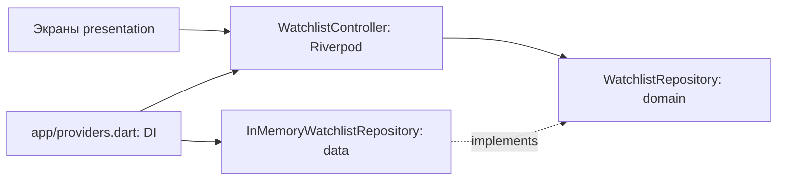

# Неделя 4 — слои, Repository и Riverpod

## Чек-лист задания

| Требование | Подтверждение |
| --- | --- |
| Основная логика на BLoC или Riverpod | Riverpod NotifierProvider и WatchlistController управляют списком просмотра |
| presentation | Экраны, темы, общие виджеты и контроллер в lib/presentation |
| domain | Movie и интерфейсы WatchlistRepository/CatalogRepository без Flutter и Riverpod |
| data | InMemoryWatchlistRepository, StaticCatalogRepository и исходные статические фильмы |
| Repository | Чтение каталога и операции списка проходят через договоры репозиториев |
| DI через get_it или Riverpod | app/providers.dart связывает договоры с реализациями; тест внедряет другой репозиторий через overrideWithValue |
| Единый основной подход к состоянию | Основное приложение не использует ChangeNotifierProvider/WatchlistModel; они остаются в учебных примерах недели 3 |

## Поток данных

Каталог также внедряется через CatalogRepository и catalogProvider. UI не импортирует статический источник из data. Источник состояния списка — снимок репозитория, который контроллер публикует после изменения. Снимки неизменяемые; одинаковый ID не создаёт дубликаты. Контейнеры Riverpod получают независимые репозитории.

Текущие источники синхронные и работают в памяти. Асинхронные операции API и хранилища потребуют расширения договоров и состояний на соответствующих неделях; работа с сетью здесь не имитируется. Подписка на внешние изменения репозитория пока не нужна: все изменения выполняет один контроллер.

## Файлы и сохранность проекта

- Новые lib/domain/models и lib/domain/repositories: перенесённая модель и два договора.
- Новые lib/data/sample_data и lib/data/repositories: перенесённые тестовые данные и реализации в памяти.
- Новые lib/presentation/screens, widgets, theme: существующий интерфейс, перенесённый в слой; экраны списка и фильма переведены на ConsumerWidget.
- lib/presentation/state/watchlist_controller.dart: основной контроллер списка.
- lib/app/providers.dart: композиция зависимостей.
- lib/main.dart: ProviderScope вместо ChangeNotifierProvider.
- Старые lib/screens, widgets, theme, models, sample_data: файлы сохранены, содержат экспорты новых реализаций. Импорты прежних тестов и учебных примеров действуют.
- pubspec.yaml/pubspec.lock: flutter_riverpod 3.4.3 и разрешённые зависимости.
- test/week_04_architecture_test.dart: репозитории, DI, изоляция состояния, пустой каталог.
- test/week_02_ui_test.dart: ProviderScope для двух тем.
- test/week_03_provider_test.dart: имя интеграционного сценария обновлено, учебные проверки Provider сохранены.
- README и этот отчёт: структура и подтверждения.

Ни один существующий файл не удалён. Учебные примеры setState, InheritedWidget, Provider, их логика и команды запуска сохранены. MovieCard и палитра не переписаны.

## Результаты проверок

- dart format: код 0; форматирование перенесённых файлов и новых тестов выполнено.
- Первый flutter analyze --no-pub: код 0, No issues found!, анализ 4,3 секунды.
- Первый запуск шести затронутых тестовых файлов: код 0, 12 тестов прошли, 0 упали (прогресс до 00:08).
- После добавления защиты пустого каталога и нового widget-теста: финальный flutter analyze --no-pub — код 0, No issues found!, 3,9 секунды.
- Повтор только затронутых трёх файлов: код 0, 10 тестов прошли, 0 упали (прогресс до 00:07). Вместе с уже проверенными неизменёнными тестами покрыты 13 разных сценариев.
- Неизменённые упражнения Dart недели 1 повторно не запускались. Visual Studio и flutter doctor повторно не проверялись.

## Ручная проверка сценариев

1. Выполнить полный restart в Chrome после смены корневой области состояния.
2. Добавить фильм со страницы деталей, вернуться в коллекцию и удалить.
3. Открыть тот же фильм снова: кнопка предлагает добавить.
4. Проверить переходы главная → детали и поиск → детали.
5. При полном перезапуске список пуст; сохранение ещё не реализовано.
6. Учебные версии недели 3 по-прежнему запускаются отдельными точками входа.

Ручная проверка обновлённого приложения в Chrome агентом не выполнялась. Неделя 5 не начата. Commit, push, смена ветки, изменение настроек Git и удаление файлов не выполнялись.
